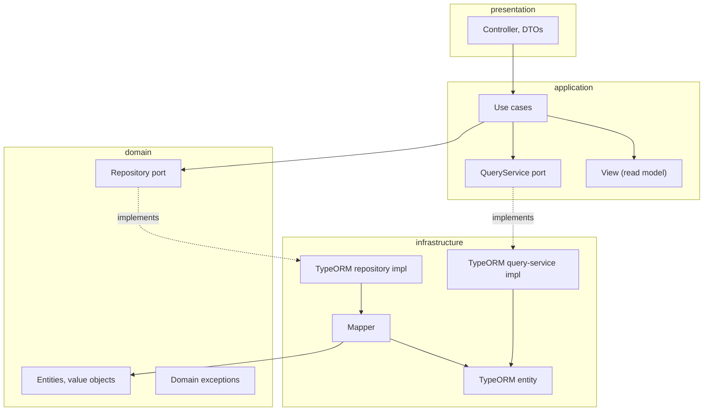

# nestjs-clean-architecture-ddd

NestJS starter wired for Clean Architecture + DDD, with a `todo` module as the reference implementation. Layer boundaries are enforced by eslint, not just convention.

## Setup

```bash
npm install
cp .env.example .env   # fill in DB credentials
npm run migration:run
```

## Run

```bash
npm run start:dev      # watch mode
npm run start           # no watch
npm run start:prod      # runs dist/main (after npm run build)
```

## Test

```bash
npm test                 # unit tests
npm test -- path/to.spec.ts
npm test -- -t "name"
npm run test:watch
npm run test:cov
npm run test:e2e
```

## Lint / format

```bash
npm run lint
npm run format
```

## Migrations

```bash
npm run migration:generate --name=AddFoo
npm run migration:run
npm run migration:revert
```

## Architecture

Each feature lives in `src/modules/<name>/` across four layers. Import direction is one-way and enforced by `eslint.config.mjs` — crossing a boundary the wrong way is a lint error, not a review comment. `src/shared/` mirrors the same four layers for cross-module kernel code.



Pure domain (no framework/ORM imports) sits at the center; infrastructure implements the domain/application ports and is the only layer allowed to know about TypeORM.

Writes and reads never share a path (CQS): a `Repository<TEntity>` port persists whole aggregates, a `QueryService<TView>` port returns plain read models for display. Both are bound per-module via DI symbols (e.g. `TODO_REPOSITORY`).

Domain errors are `DomainException` subclasses with a `DomainErrorType` and a string key; `src/error-codes.ts` is the single catalog mapping every key to a numeric code (a key that's thrown but not registered fails loudly rather than silently). The global `HttpExceptionFilter` turns any thrown error into the API's error envelope.

See `CLAUDE.md` for the full set of conventions (error-code ranges, base classes, module wiring, response envelope, etc.) and `/create-api` to scaffold a new feature following them.

## Stack

NestJS 12 · TypeORM + PostgreSQL · class-validator/class-transformer · Jest · ESLint + Prettier · Husky + commitlint (Conventional Commits)
